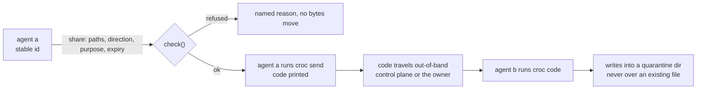

# a2a: two agents handing each other a file

an orphan line. it does not import from `main` and `main` does not import it.

this is a contract, not a plan. it says what a share between two agents is allowed to be, and what
it is refused for, because the interesting part of agent-to-agent files is not the transport: `croc`
already solves moving bytes between two computers that have never met. the interesting part is
**permission**, and permission is the thing nobody gets to improvise at the call site.

## the case this is for

**two decoupled agents**, each with its own identity and its own machine, where one genuinely has to
hand the other a file. a transcript, a dataset, a rendered artefact, a build output. they are not the
same agent, they do not share a home directory, and neither can read the other's disk.

the cases this is *not*:

- **not one agent across two devices.** that is the same principal on two machines, which is a
  profile-sync problem and the pinned guest profile already answers it. borrowing this lane for it
  would mean a share that grants nothing, to yourself.
- **not a shared drive.** a shared drive is a standing capability over everything in it. a share here
  is one direction, named paths, one expiry, and it is gone afterwards.
- **not a message bus.** bytes move; nothing is queued for a stranger. conversation belongs to `comms`
  and its lanes.
- **not a secret channel.** the vault plane moves credentials between machines on purpose and with a
  broker. a file share is for payloads. secrets-shaped paths are refused here for that reason, not
  because we distrust the transport.

## the trust anchor: a fleet is the owner's set of agents

an agent's principal is its stable id: a sha256 commitment of a vault-held seed, minted once and
never derived from a name. a share is authorized against that id, and the display name is a label
attached to it, which is the same rule the control plane already holds for grants: **a name is never
the identity**, so nobody can be spoofed by being spelled correctly.

a fleet is therefore not a network and not a room. it is the set of principals under one owner. that
is the whole boundary: a share whose peer is outside the fleet is refused, and there is no
"everyone" to address, because "send to all of them" is N shares, each with its own purpose.

## a share, in one shape

```json
{
  "from": "sha256:6f2c...", "to": "sha256:91ad...",
  "paths": ["/var/artefacts/report-2026-11-02.tar.gz"],
  "direction": "send",
  "max_bytes": 536870912,
  "expires_in_hours": 6,
  "purpose": "the november report, so you can index it",
  "code_exchange": "out-of-band"
}
```

`direction` is `send` from the sender's side; `receive` is the same share seen from the other end, and
`both` is two shares, not one. `purpose` is required because a grant nobody can explain in a sentence
is a grant that will be renewed forever.



## the transport, chosen rather than admired

the bytes go over an existing oss transfer tool. what this lane adds is the grant in front of it, the
scoping, and the refusals.

**croc is the chosen one for a one-shot handoff.** from its own readme: p2p with relay fallback, end
to end encryption by PAKE over a code phrase, multiple files and folders, resume, no port forwarding.
it is a single static binary on linux, macos and windows, which matters for a fleet whose members are
not all the same operating system. the code phrase is the capability, so the exchange of that code is
the moment that has to be controlled, and that is exactly what a grant records.

**magic-wormhole is the alternative worth naming**, for the same `spake2` reasoning with a python
library and a rendezvous server instead of a code phrase on a cli. not chosen first because a
long-lived python dependency per guest is a heavier thing to put on every member of a fleet than a
binary that only exists while a transfer runs.

**syncthing is refused for this job.** it is excellent at continuous two-way sync, and continuous sync
is the wrong shape here: it means the file lives on both sides for as long as the folder is shared,
so "revoked" becomes a promise about a peer's behaviour rather than a fact about a capability. a
standing shared folder is a fleet decision for later, and it is not this lane.

**a network overlay is not a file lane.** wireguard or tailscale put members on one address space;
that is a routing decision. it does not decide which paths, in which direction, until when.

## limits, because a grant with no ceiling is a wish

- **bytes**: 512 mb per share by default, 2 gb hard ceiling. bigger means the wrong tool, not a bigger
  ceiling.
- **time**: one hour minimum, 24 hours maximum. a share that outlives its purpose is a share nobody is
  watching.
- **paths**: named paths, at most 16, each one an exact file or a directory the sender declares. no
  `/`, no `~`, no `..` escapes, no globs that could resolve into something else later.
- **the destination is a quarantine directory.** the receiver writes into one folder it owns, and an
  existing file is never overwritten silently: a collision is a decision, and the decision belongs to
  the receiving agent's own rules, not to the sender's convenience.

## what is refused, and why each one is a card and not a footnote

- **a share outside the fleet.** trust is the owner's set of principals. there is nothing outside it
  to be generous towards.
- **an unscoped share**: a whole home directory, `/`, or a path list that names no files.
- **a share with no purpose, or no expiry.** the two fields that make a grant reviewable.
- **broadcast.** fan-out is one share per peer, each with its own purpose and expiry, so revoking one
  does not silently leave eight.
- **silent overwrite at the destination.** replace is an act the receiver takes, never a side effect of
  arriving.
- **a secrets-shaped path**: `.ssh`, `.gnupg`, `.aws`, `.netrc`, `id_*`, `*.pem`, `*.key`, a browser
  profile. credentials move through the vault plane, not through a file share, and the transport's own
  tooling already rejects some of these for its own reasons.
- **borrowed identity**: an agent may send as itself. a share that claims a `from` it does not hold is
  refused before any transport is started.
- **auto-accept.** the receiving side is a decision. the only standing rule allowed is one the owner
  wrote down, and even then it is scoped to a sender and a path.

## what is built today

nothing has transferred yet, and this readme is the reason to be precise about it:

- **the grant model, checked.** `a2a/grants.py` holds the shape, the limits, the transports and the
  refusals as data, and `plan(share)` returns either the exact two commands to run or the named reason
  it will not. that is testable today and tested.
- **not built**: code exchange, the quarantine writer, revocation, a self-hosted relay, and any wire
  format between the control plane and a member. each one is named here rather than half done.
- **never**: a public relay, a share that outlives its purpose, or an agent that accepts on behalf of
  another.
