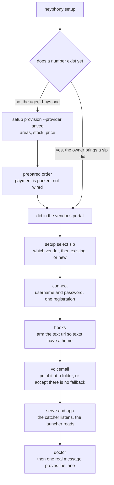
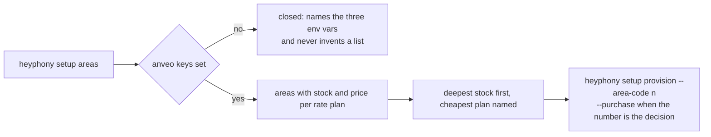
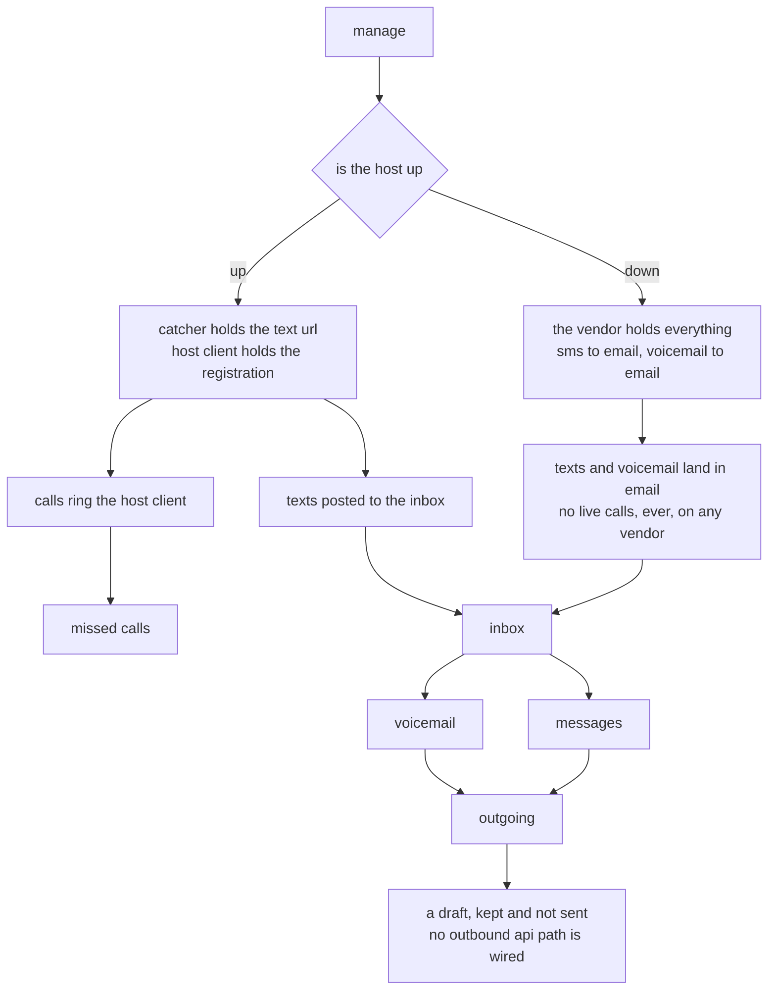
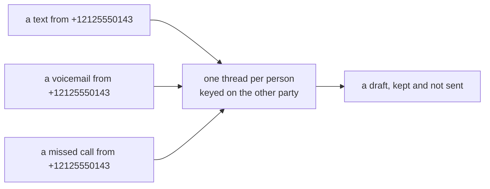

# directory: how to read this folder

this file exists because a person opened the repo, saw a flat pile of python files, and could not tell how any of it runs. that is a defect in the folder, not in the reader. so the folder is now two things side by side: prose that says what happens, and code that does it, in the same named place.

the rule that keeps them honest: **a folder with a readme is a description, a `.py` is the work.** if you can read `src/manage/turnedoff/readme.md` you know what happens when the host is asleep without opening a file that starts with `import`. if you are changing behaviour, the readme and the module move in the same commit, and a test fails when they drift.

## the shape

```
heyphony/
  directory.md                  this map
  readme.md                     what heyphony is, and why it is a workaround
  src/                          everything that runs
    providers.py                the vendor table: price, how texts arrive, what works while off
    runner/                     how a person or an agent reaches it
      cli.py                    the commands
      gui.py                    the launcher page: caught messages, voicemail, calls
    linphone/                   the sip client, wrapped
      sip.py                    registration plan, config it writes, call log reads
    setup/                      getting from no number to a number that answers
      flow.py                   the setup plan, as data
      provision.py              anveo: areas, order, arm the text url
      routes.py                 per vendor: the hook, its payload, how to arm it
      test/                     the proof step
      commands/                 which command settles which part
    manage/                     everything after the number exists
      turnedon/                 routing while the host is up
      turnedoff/                routing while the host is down
      inbox/                    what arrived: texts, voicemail, missed calls
      outgoing/                 what leaves, and what is refused
      inbox.py  views.py        storage and the read views
      catcher.py mailparse.py   the front door and the carrier email parser
    onramp/                     rails a number unlocks
      flow.py  signal.json      signal, as data
  journal/                      explainers and dated notes
  theidea/                      the argument for the shape
  providers/                    per vendor notes
```

## two flows, not one

setup happens once and ends when the number answers. managing it happens every day after that, and the agent lives in the second one. mixing them in a single diagram is how the folder got confusing in the first place, so they are drawn apart.

### the setup flow



the two branches matter because the vendor is chosen for different reasons on each. when the agent buys its own, the question is stock and price in an area code, and only anveo answers that over an api today, so it is the one path a cli can finish. when the owner hands over a did they already own, the question is only where the password lives, and that is one command.

### the area lookup

the one place setup is allowed to ask a question after the number exists: which area code, before the order.



### the manage flow



the interesting fact in that picture is that the left branch never carries a text. sms does not travel over sip, so a vendor holds it and posts or emails it, which is exactly why the inbox works with the machine asleep. calls are the opposite: they are sip, so they need a registration, and a registration lives on a host that is running.

### what a person sees

the inbox keeps channels apart because they arrive by different roads. the launcher puts them back together, because nobody thinks of a person as three channels.



that thread key is the only piece of identity this package owns. anything wider, meaning the same person across email, whatsapp and slack as one card, belongs to the umbrella in `comms/recognica/`, and heyphony deliberately does not grow a second copy of it.

## where the code sits

| folder | the question it answers | the python |
| --- | --- | --- |
| `src/runner/` | how do i run it, and how does an agent | `cli.py`, `gui.py` |
| `src/linphone/` | what does the sip client do, and with what config | `sip.py` |
| `src/setup/` | how does a number come to exist and start answering | `flow.py`, `provision.py`, `routes.py` |
| `src/manage/` | what happened while i was not looking | `inbox.py`, `views.py`, `catcher.py`, `mailparse.py` |
| `src/onramp/` | which rails open once a number exists | `flow.py`, `signal.json` |
| `src/providers.py` | which vendor, at what price, routing where | data, no logic worth the name |

## what is not here

no pbx, no queue, no extensions, no presence, no hold and transfer. a single number with one registration does not need a switchboard, and pretending otherwise would mean running asterisk to answer one person. `journal/pbx-vs-softphone.md` has the full comparison, and `journal/softphones.md` walks the protocol if you want the ground under all of it.
