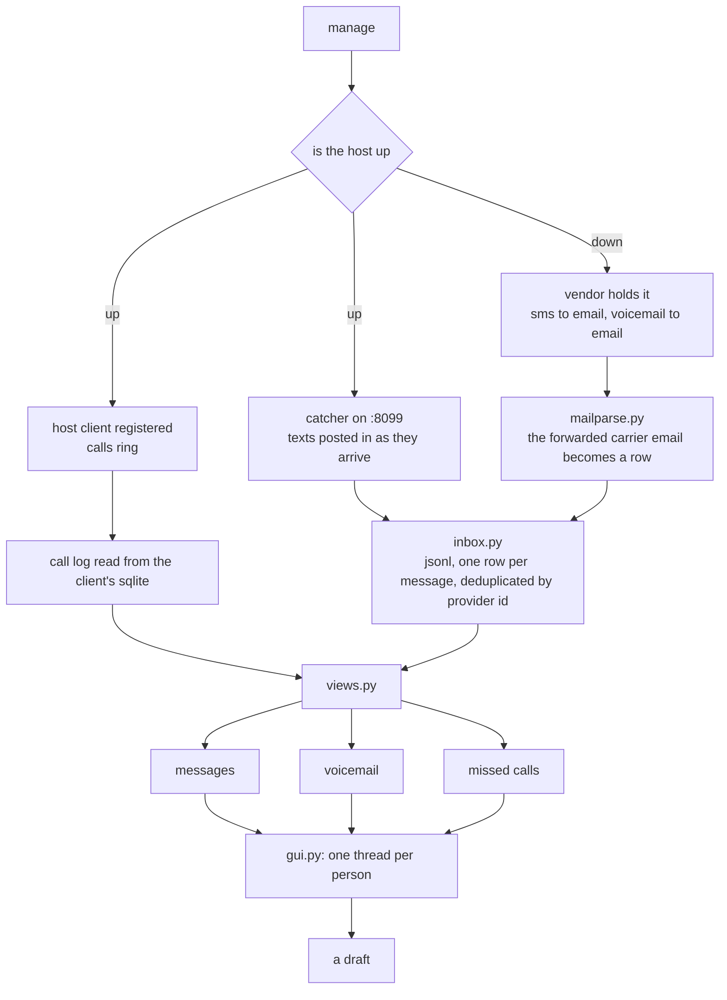

# manage: the number answering

setup ends. this folder is everything after, and it is where the agent actually lives: what arrived, who it was from, what happened when nobody answered, and what a reply would be if a send rail existed.

## the two states, as folders

`turnedon/` and `turnedoff/` are not modules, they are the two routing worlds, and each has its own page because the difference is not a setting. when the host is up, texts are posted to a url this host is serving and calls ring a client this host is running. when it is down, a vendor with carrier side forwarding emails the text and the voicemail, and a vendor without it holds nothing, so the message is simply gone. the per vendor table is in `turnedoff/readme.md` and the data behind it is `../providers.py`.

## the inbox, and what "unread" means

`inbox/` has one page per kind of thing that arrives: texts, voicemail, missed calls. storage is a jsonl file, deduplicated by the provider's own id, because a retried webhook is not a second text. read state is a sidecar file next to it, because a provider webhook never says whether anyone looked, and pretending a delivery implies reading makes the question "is this new" unanswerable.

## and what leaves

`outgoing/` is short and honest: a draft is kept, nothing is sent. when a send rail is wired it will be sms on this number, paid per message, and not imessage, which lives in the umbrella because it is a different rail with a different free tier.
