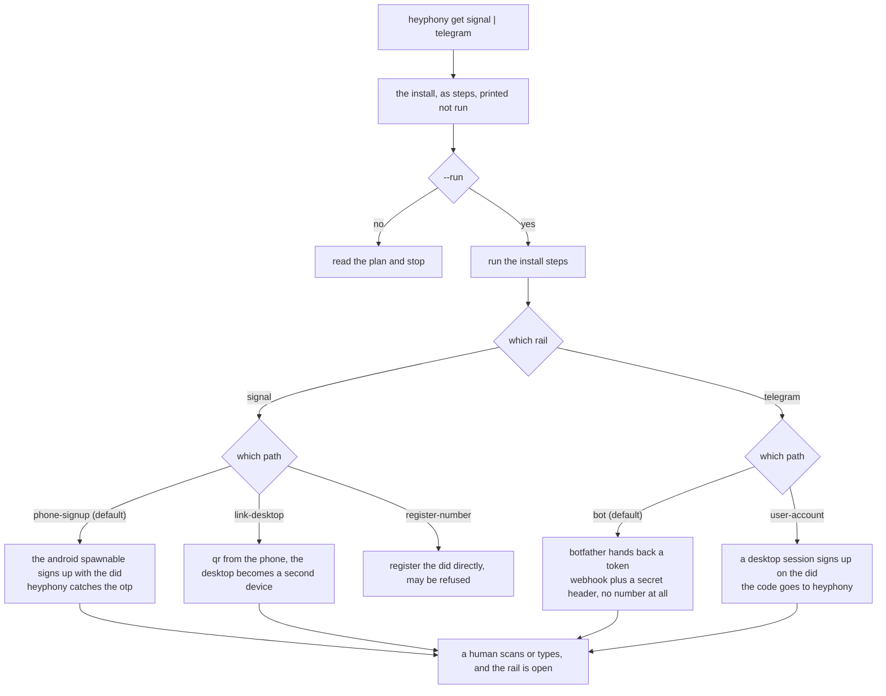

# onramp: rails a number unlocks

some services will not talk to a program until a program has a phone number. a getter is the recipe for opening one of those rails, and it is a recipe rather than code because what it does is install somebody else's software and then leave a human one step to do.

## signal, which is built

`signal.json` carries three paths with phone signup as the default, because it is the only one where the phone is the identity of record and the desktop is a secondary device: one identity, two devices, the relationship a person has with their laptop. the recipe carries the install command, the verify step and the refusals, and `heyphony get signal` prints it while `--run` executes only the install steps. the qr scan is listed as a human act and never performed, because a linked device is an identity and identities are not automated.

## telegram, which is two rails

telegram is the one rail here that does not need a number to be reachable, and it is two different things wearing one name, so the recipe carries both and says which is which.

**the bot.** a token, a webhook url and a secret header. no phone, no sim, no account to lose, revocable in one message to botfather. this is the rail telegram actually supports for programs, and the umbrella already reads it in `telegram/`, so the getter exists to say so plainly and to set the webhook where the lane expects it. `heyphony get telegram` defaults to this path.

**the user account.** a person, not a program: a number, a desktop session, contacts that cannot be recreated if the account is lost. the number comes from the did heyphony already holds, and the signup code goes to the inbox instead of a handset, which is the same trick signal uses. this is the path that is genuinely risky, and the recipe says so in the field rather than between the lines: telegram asks more of a number than signal does, and a voip did is a number it has seen before. expect a chat, a wait, or a refusal.

the honest split is worth keeping in view: the bot half is software, the account half is a person. a bot can be replaced in a minute and an account cannot be replaced at all, so the recipe refuses the shortcuts that blur them, starting with using an mtproto api id as though it were a bot token. that route binds the account behind the id to everything the client does.

## what a getter is not

not a lane. a lane lives in the umbrella and owns a carrier, a gate and a state. a getter is the one command this package can offer because it already holds the thing the rail wants: a number with sms, or a host with a webhook pointing at it.

two getters is the whole list, and that is a feature. a folder of thirty recipes would be a directory of half-executed installs; two that print their own steps, name their refusals and leave the human act where the human is, are ones a person can actually finish.
