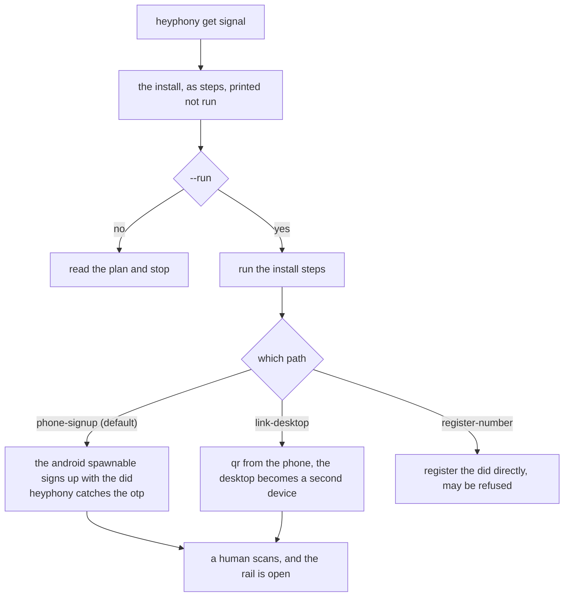

# onramp: rails a number unlocks

some services will not talk to a program until a program has a phone number. a getter is the recipe for opening one of those rails, and it is a recipe rather than code because what it does is install somebody else's software and then leave a human one step to do.

## signal, which is built

`signal.json` carries three paths with phone signup as the default, because it is the only one where the phone is the identity of record and the desktop is a secondary device: one identity, two devices, the relationship a person has with their laptop. the recipe carries the install command, the verify step and the refusals, and `heyphony get signal` prints it while `--run` executes only the install steps. the qr scan is listed as a human act and never performed, because a linked device is an identity and identities are not automated.

## telegram, which is later

telegram is on the list and not written, and the reason is that it may not belong here at all. the umbrella already has a telegram lane with a bot token, a webhook secret and a chat whitelist, and a bot needs no phone number. what a number would buy is a user account rather than a bot, which is a different thing to be responsible for: a bot is a service you run, a user account is a person.

so the honest state is: nothing is planned beyond this paragraph. if it arrives it will arrive as a recipe with the same shape as signal's, and if it turns out a bot is enough, the answer is the umbrella and this folder stays empty on the subject.

## what a getter is not

not a lane. a lane lives in the umbrella and owns a carrier, a gate and a state. a getter is the one command this package can offer because it already holds the thing the rail wants: a number with sms.
