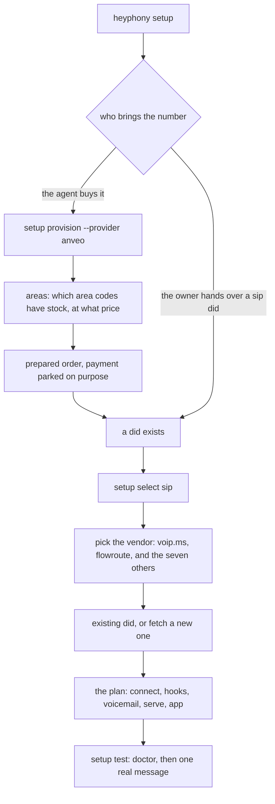

# setup: no number, then a number that answers

setup is the one-time flow, and it has two entrances because a number can come from two directions. everything in this folder serves one of them, or the step between them.

## the two entrances, and why they are different work

when the agent buys its own number the question is inventory: which area code, is it in stock, what does the rate plan cost per month, and does the vendor let a script place the order. exactly one of the ten vendors answers all of that over an api today, which is why `provision.py` exists for anveo and nothing else. the order is prepared and printed with `--purchase` deliberately unimplemented, because the order is the payment step and no payment rail is wired.

when the owner hands over a did the question shrinks to where the password lives. that is one command, and the whole plan is a dict you can read before running anything.

## the steps, in the order they must happen

the sequence is not decorative. each step is what makes the next one testable.

| step | what it settles | if you skip it |
| --- | --- | --- |
| confirm the did is sms capable | whether texts can arrive at all | you own a voice only number and find out weeks later |
| fetch sip credentials | the registration | nothing rings |
| connect on the host | one registration, one secret, 0600 | a guest burns and takes the password with it |
| arm the text hook | where a text goes | the vendor has no url to post to and sms quietly dies |
| point voicemail at a folder | what happens when nobody answers | calls ring out into nothing instead of becoming a file |
| serve and app | the catcher and the reader | messages arrive nowhere a person can read them |
| doctor, then one real message | nothing is designed any more | you believe a lane works because it is configured |

that last row is the whole ethos in one line: a number that has never received a message is not a number that works.

## what lives here

- `flow.py`: the setup plan as data, per vendor, including the flags that let an agent drive the menu.
- `provision.py`: anveo, end to end: signature, areas, order, arm the sms url, verify.
- `routes.py`: per vendor, how texts arrive, what the payload looks like, and the call that arms it.
- `test/`: the proof step, described.
- `commands/`: which command settles which part, in one table.
