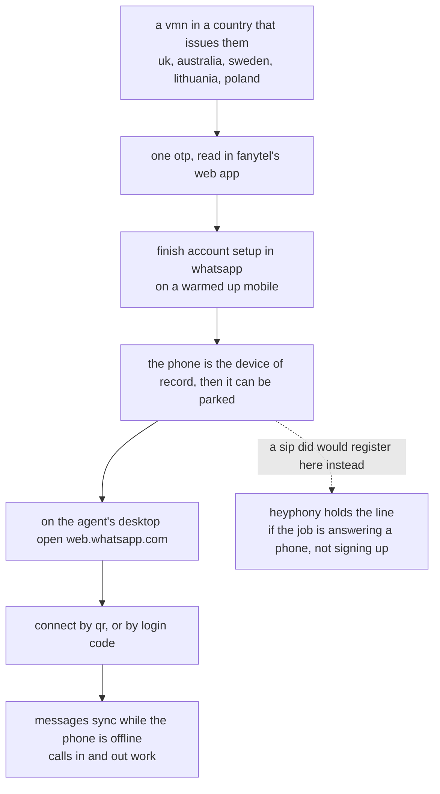

# whatsapp

a waha session on the owner's own number. the same seat the human uses, not a
business api with a template approval queue.

wired: the hmac gate (hex hmac over the raw body, algorithm named in the event's
own header) and a digits-only whitelist. groups are never whitelisted: a group is
a room, not somebody asking the agent a question.

not wired: media beyond text, and the session itself (waha logs in by qr, which is
a human act, and that is correct: it is their account).

gate: `WAHA_HMAC_KEY`, `HEYPHONY_WHATSAPP_WHITELIST`.

## the number problem, and the one path that works

whatsapp is the strictest of the nine about the number behind the account, and it is strict about a
property the number either has or does not: whether the country you bought it in treats a cloud number
as a mobile number. nothing about the app, the client or the vpn changes that answer.

two different questions hide in that sentence, and keeping them apart is the whole trick:

- **can a machine hold it?** that is a sip question. a did from voip.ms, anveo, bulkvs or jmp.chat is
  real sip: the host registers it, heyphony catches its texts, and it rings while the machine is up.
- **will whatsapp accept it?** that is a legal question about the number's class in the country that
  issued it, and it is the one that gets refused.

in the uk the class has a name, a virtual mobile number, and the category exists because the
regulator expects the provider to behave like a carrier.

**fanytel answers only the second.** it is a web-hosted service, not a sip endpoint: the number lives
in their app and receives its codes there, and it cannot be registered in baresip or linphone. that
is fine for what it is used for here, signing an account up once, and useless as a softphone line. a
provider did in the same country is the other way round.

### the countries, and why the list is short

a cloud number is a mobile number in exactly the places where the numbering plan gives cloud providers
mobile ranges and expects them to behave like carriers. **the uk and australia** do it, **sweden,
lithuania and poland** do it, and **the netherlands** does it too at a price that only makes sense if
the workflow is already paying for itself. in **the us, canada and the +1 countries** the same service
is a did, a voip number, and everything that is not a carrier's own sim is one bucket, which is why a
`+1` number is the wrong tool no matter who sells it.

that difference is not a disguise and not a workaround for a rule. nothing here spoofs a number, a
location or a device: the number is a mobile number because the country says it is, and the account is
an ordinary account on an ordinary number.

the cost follows the same logic and is worth stating plainly: a uk number costs more than a us one,
and an australian one more again, so which country to buy in is a question about the agent's workload
rather than a preference.

### the same reasoning, for google

google accounts land the same way and for the same reason, which is why they are noted here rather than
in their own folder: a uk or australian number tends to work, and it is the price question again
rather than a technical one. if an agent's week includes google, buying the number in a country that
issues them is the decision that makes both work.
